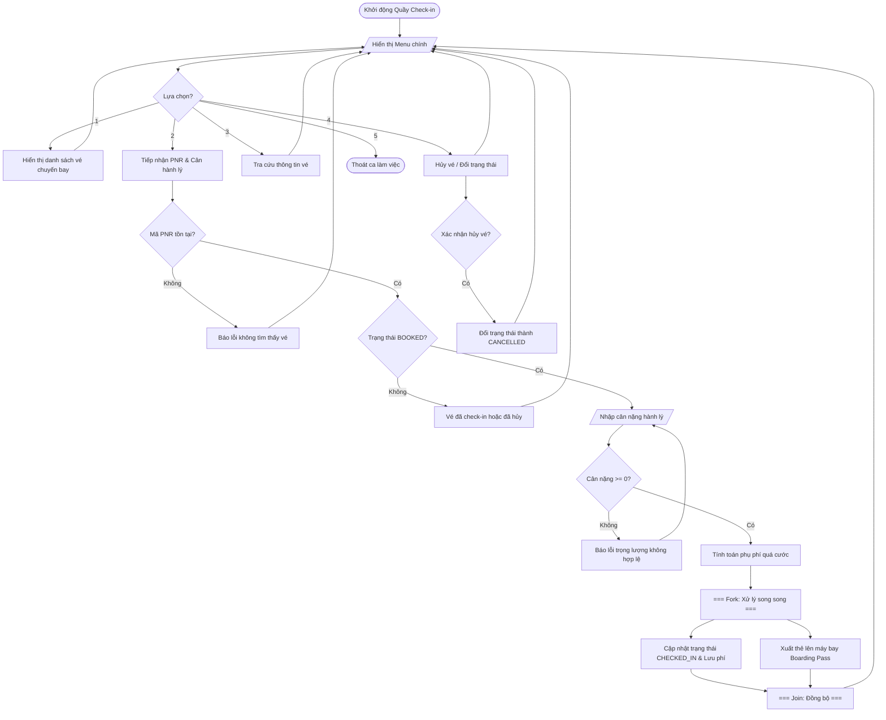

# BÁO CÁO HOÀN THIỆN ĐỒ ÁN CAPSTONE QUẢN LÝ VÉ MÁY BAY & HÀNH LÝ KÝ GỬI

> 👤 **Học viên:** Hoàng Công Dũng | **Mã SV:** PTIT-HCM-009
> 🏫 **Môn học:** it103b-rl-HoangCongDung

---

## 📊 Sơ đồ thiết kế hệ thống (Activity Diagram)

> 💡 *Sơ đồ dưới đây được render tự động trực tiếp trên GitHub bằng Mermaid. Bạn cũng có thể tải file **`bt1.drawio`** trong repository này để mở và chỉnh sửa trực tiếp trên [Draw.io (diagrams.net)](https://app.diagrams.net).* 

---

## 1. Mục tiêu và Bối cảnh bài toán

Bài tập số 1 thuộc Session 13 yêu cầu tôi xây dựng và hoàn thiện ứng dụng dòng lệnh (CLI Console App) quản lý vé máy bay và hành lý ký gửi bằng ngôn ngữ JavaScript.

Hệ thống mô phỏng quy trình thực tế tại quầy thủ tục sân bay, nơi nhân viên mặt đất thao tác liên tục với việc tra cứu PNR, tiếp nhận check-in, tính phụ phí quá cước và in thẻ lên tàu bay.

- Sử dụng cấu trúc mảng các đối tượng (Array of Objects) để lưu trữ danh sách vé.', 'Áp dụng vòng lặp do-while kết hợp switch-case để duy trì luồng menu tương tác liên tục.
- Thiết kế các hàm nghiệp vụ độc lập theo chuẩn Clean Code.

## 2. Quy tắc nghiệp vụ và Xử lý bẫy dữ liệu

Trong quá trình viết mã, tôi đã đặc biệt chú ý đến các ràng buộc nghiệp vụ quan trọng để tránh lỗi phát sinh khi người dùng nhập liệu sai.

Các trường hợp ngoại lệ (Edge Cases) đều được kiểm tra kỹ lưỡng trước khi thực hiện tính toán tài chính hoặc thay đổi trạng thái vé.

- Định mức hành lý miễn cước: ECONOMY được 20 kg, BUSINESS được 30 kg. Phần vượt quá bị tính phí 50.000 VNĐ/kg.
- Kiểm tra tính hợp lệ của cân nặng hành lý: Trọng lượng nhập vào bắt buộc phải lớn hơn hoặc bằng 0, nếu nhập số âm hệ thống sẽ yêu cầu nhập lại.
- Quản lý trạng thái vé chặt chẽ qua 3 mốc: BOOKED, CHECKED_IN và CANCELLED.

## 3. Bảng đặc tả chi tiết quy trình nghiệp vụ

Dưới đây là bảng đặc tả các bước thực hiện trong ứng dụng dòng lệnh quản lý vé máy bay:

| Bước | Chức năng | Thao tác người dùng / Hệ thống | Kết quả / Điều kiện kiểm tra |
| --- | --- | --- | --- |
| 1 | Hiển thị Menu | Hệ thống in ra menu 5 lựa chọn | Chờ nhận phím bấm từ 1 đến 5 |
| 2 | Xem danh sách vé | Chọn tùy chọn 1 | In ra bảng danh sách toàn bộ vé hiện có |
| 3 | Check-in hành lý | Chọn tùy chọn 2 và nhập mã PNR | Kiểm tra PNR tồn tại và trạng thái BOOKED |
| 4 | Cân hành lý | Nhập trọng lượng hành lý ký gửi | Kiểm tra trọng lượng >= 0, tính phụ phí nếu vượt định mức |
| 5 | Xuất Boarding Pass | Hệ thống tự động thực hiện | In thông tin thẻ lên máy bay và cập nhật trạng thái CHECKED_IN |
| 6 | Tra cứu / Hủy vé | Chọn tùy chọn 3 hoặc 4 | Tra cứu thông tin chi tiết hoặc chuyển trạng thái sang CANCELLED |
| 7 | Thoát chương trình | Chọn tùy chọn 5 | Kết thúc ca làm việc của ứng dụng dòng lệnh |

## 4. Đánh giá kỹ thuật và Hướng dẫn kiểm thử

Mã nguồn được tổ chức thành các hàm độc lập rõ ràng giúp dễ dàng bảo trì và kiểm thử đơn vị.

File capstone_flight_checkin.js đã được đẩy lên GitHub Organization it103b-rl-HoangCongDung đúng theo yêu cầu của giảng viên.

---

## 📁 Danh sách tệp tin nộp bài trong Repository
- 📝 `bt1.docx`: Báo cáo tài liệu phân tích nghiệp vụ hoàn chỉnh.
- 🎨 `bt1.drawio`: File thiết kế sơ đồ chuẩn theo quy định đề bài (mở trực tiếp bằng [Draw.io](https://app.diagrams.net) hoặc Lucidchart).
- 💻 `capstone_flight_checkin.js`: Mã nguồn chương trình.
